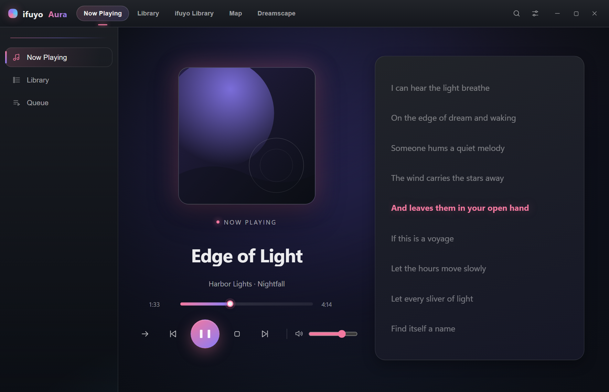
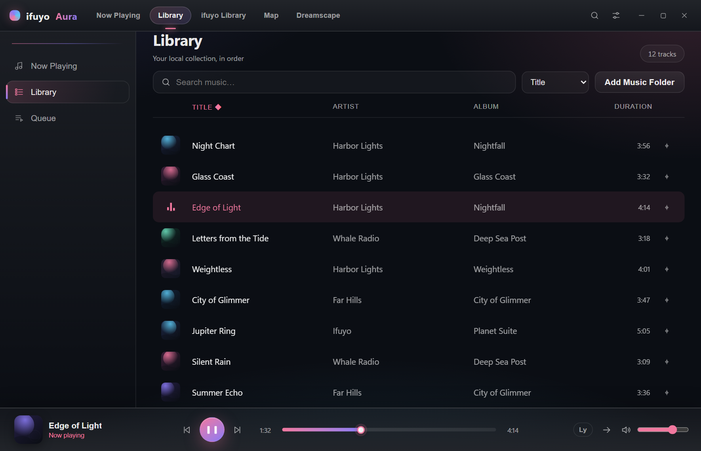
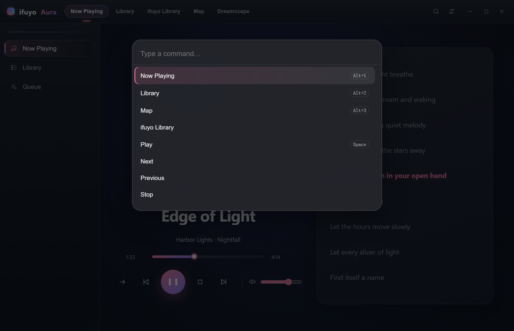
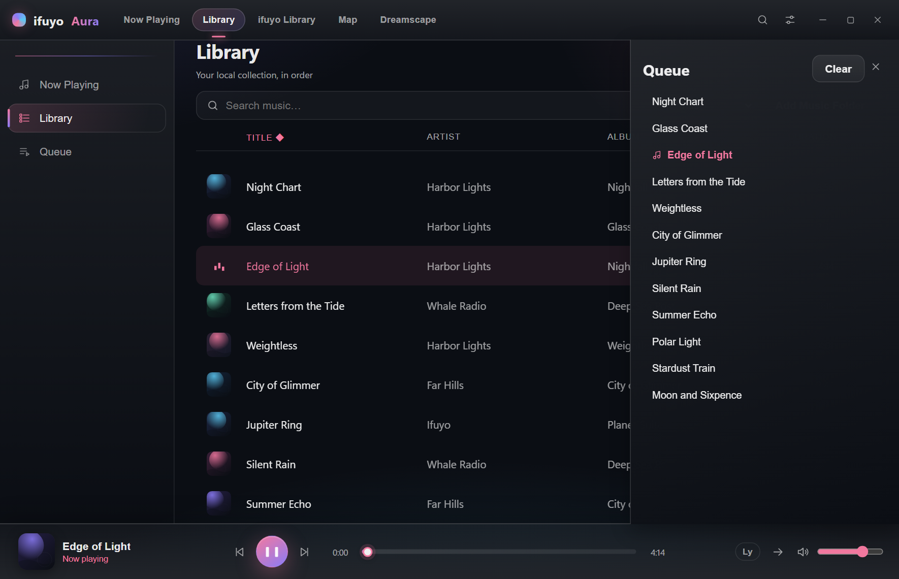

# ifuyo Aura

**Weave light and dreams into every session.**

A local-first, legal-source, telemetry-free desktop music player for Windows.
Built with Tauri 2, Rust and React.

**English** · [简体中文](README.zh-CN.md)

[](#license)
[](#build)
[](https://tauri.app)



## Why ifuyo Aura

- **Local first.** Your library stays on your disk. No account, no cloud sync, no upload.
- **Legal sources only.** Local files, direct HTTP(S) streams, Internet radio, and a self-hosted catalog — commercial-platform ripping is blocked by design.
- **Zero telemetry.** No analytics, no tracking, no "phone home". The network is used only when *you* ask for a stream.
- **Quietly capable.** Gapless playback, crossfade, loudness normalization, a 10-band EQ, a command palette, and a fully local Music Map.

## Features

| Area | What you get |
| --- | --- |
| Playback | FLAC / MP3 / OGG / WAV / M4A / ALAC, gapless, crossfade 0–12 s, loudness normalization (−16 LUFS), 10-band EQ with presets |
| Library | Folder scan, SQLite FTS5 search (including CJK), artwork extraction, file watcher, paging for large libraries |
| Sources | Direct HTTP(S) audio, Internet radio with ICY metadata, Radio Browser, self-hosted **ifuyo** catalog |
| Cache | Chunked range cache with WAL, LRU eviction, pinning, integrity verification |
| Views | Now Playing, Library, Queue drawer, Mini Player, always-on-top desktop lyrics, Music Map, Dreamscape |
| Map | Local audio analysis → cosine similarity → k-NN graph → deterministic 2D layout; search, filters, neighbors |
| Dreamscape | Deterministic light field driven by track features and live levels (WebGL2 + CSS fallback) |
| Windows | SMTC (system media panel + media keys), tray menu, single instance, Win11 Mica with solid fallback |
| Experience | Command palette (`Ctrl+K`), `Alt+1…4` navigation, keyboard-first controls, reduced-motion support |
| Language | English and 简体中文, switchable at runtime |

## Screenshots

Captured from the real UI. The library shown is a fictional demo dataset, not a bundled catalog.

| Now Playing | Library |
| --- | --- |
|  |  |
| **Command Palette** | **Queue** |
|  |  |

Screenshots are reproducible with `node scripts/capture-readme-shots.mjs` (headless Edge + a mocked IPC layer). The Chinese set lives in [`docs/screenshots/zh-CN`](docs/screenshots/zh-CN) and is used by the [Chinese README](README.zh-CN.md).

## Build

Requirements: Rust stable (MSVC), Node.js 20+, WebView2 Runtime.

```powershell
# Frontend
cd ui
npm install
npm run build            # outputs ui/dist

# Desktop app (embeds ui/dist; same compile step as `tauri build`)
cd ..
cargo build --release -p aura-shell --features custom-protocol
# Output: target/release/aura-shell.exe

# Or via the Tauri CLI
cargo tauri build        # unsigned artifacts
```

> `ui/dist` changes do not trigger a cargo rebuild (D-075). Touch `src-tauri/src/lib.rs` before repackaging.

## Development

```powershell
cd ui && npm run dev     # Vite dev server on :5173
cargo run -p aura-shell  # in another terminal; debug builds use devUrl
```

Quality gates (same as CI):

```powershell
cargo fmt --check
cargo clippy --workspace --all-targets -- -D warnings
cargo test --workspace
cargo deny check
cd ui && npm run typecheck && npm run lint && npm test && npm run build
```

Desktop smoke test (real window): `cargo run -p aura-shell --bin smoke`.

Architecture: [ARCHITECTURE.md](ARCHITECTURE.md) · Decisions: [DECISIONS.md](DECISIONS.md) · Milestones: [PROGRESS.md](PROGRESS.md) · Changelog: [CHANGELOG.md](CHANGELOG.md).

## Privacy

- **No telemetry, no analytics, no account, no cloud sync.** Network access happens only when you play a direct URL or browse radio.
- No bundled music. Documents/Desktop/full disks are never scanned automatically — you add music folders explicitly.
- Commercial-platform URLs (YouTube, Spotify, NetEase Cloud Music, …) are rejected by the blocklist in `config/unsupported_platforms.json` before any request is made.

See [PRIVACY.md](PRIVACY.md) for the full data-flow description.

## Security

ifuyo Aura is pre-alpha software. Security design highlights:

- **Strict URL policy.** Only `http`/`https`; URL credentials rejected; every redirect hop is re-validated (max 5 hops); private-network and loopback targets are denied unless the user explicitly confirms a LAN source; DNS results are re-checked on every resolution to prevent rebinding.
- **Bounded inputs.** Response bodies, ICY metadata, redirects, batch sizes, seek values, volume, crossfade and EQ indices are all clamped or rejected at the IPC boundary; persisted settings are normalized on read and write.
- **Minimal capabilities.** Tauri allowlist is limited to window controls and dialogs — no shell, no arbitrary filesystem or HTTP plugin. CSP blocks remote scripts, styles, fonts and images.
- **Local-only state.** Credentials (if a source ever needs them) go to Windows Credential Manager, never to disk or logs. Log messages redact URL userinfo and query strings.
- **Update integrity.** Manifests are validated and downgrade-rejected; release signatures are verified before installation.

Report vulnerabilities through GitHub **Security Advisories** (private). Please do not open a public issue with details. Full policy: [SECURITY.md](SECURITY.md).

## Status and honest limitations

- Installer artifacts are **unsigned**; the update endpoint is a development/fake server in this repository and is not a working public auto-update channel.
- Music analysis uses classic statistical algorithms (not ML); BPM/key accuracy on real-world music has not been benchmarked.
- Dreamscape is a light-field renderer (fBm aurora, star field, light dust, mirror); full-screen mode, weather presets and multi-world slots are not implemented.
- Multi-hour desktop soak testing was not executed in this development environment (remote virtual display).
- Mica is confirmed on Win11; Windows 10 falls back to a solid surface by design.

## License

Dual-licensed under either of:

- **Apache License, Version 2.0** — [LICENSE-APACHE](LICENSE-APACHE)
- **MIT License** — [LICENSE-MIT](LICENSE-MIT)

at your option. Unless you explicitly state otherwise, any contribution intentionally submitted for inclusion in this project shall be dual-licensed as above, without any additional terms or conditions.

Third-party notices: [THIRD_PARTY_LICENSES.md](THIRD_PARTY_LICENSES.md) · Content rules: [CONTENT_POLICY.md](CONTENT_POLICY.md) · Source policy: [SOURCES.md](SOURCES.md).

---

Copyright © 2026 ifuyo · 伊芙游 · <https://ifuyo.com>
