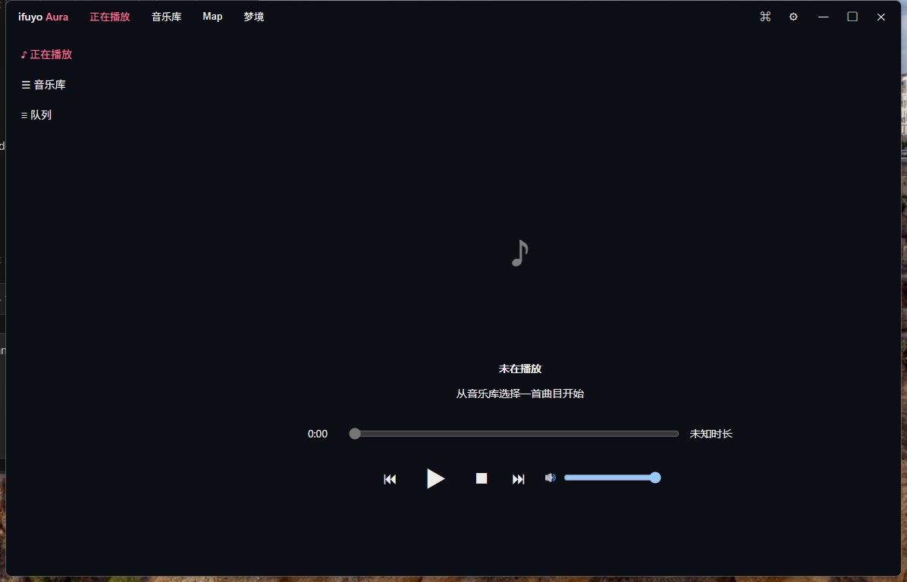
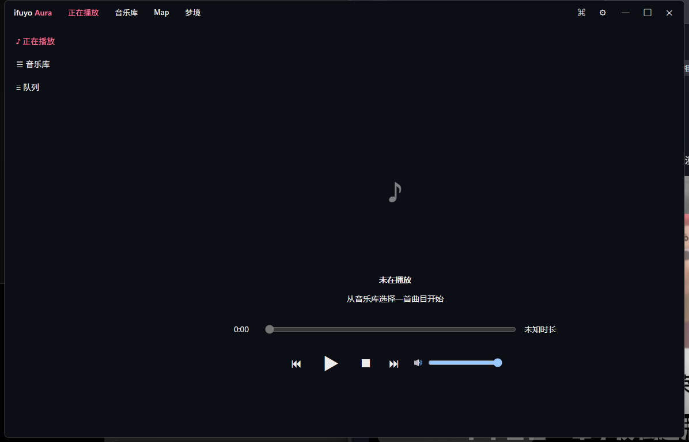
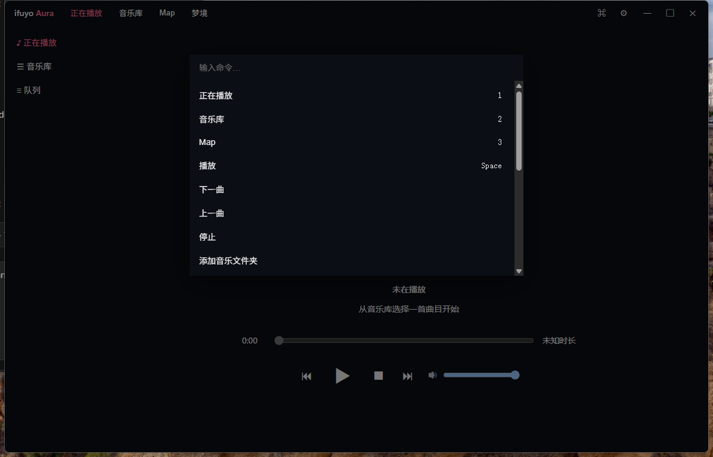
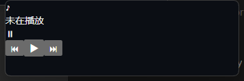
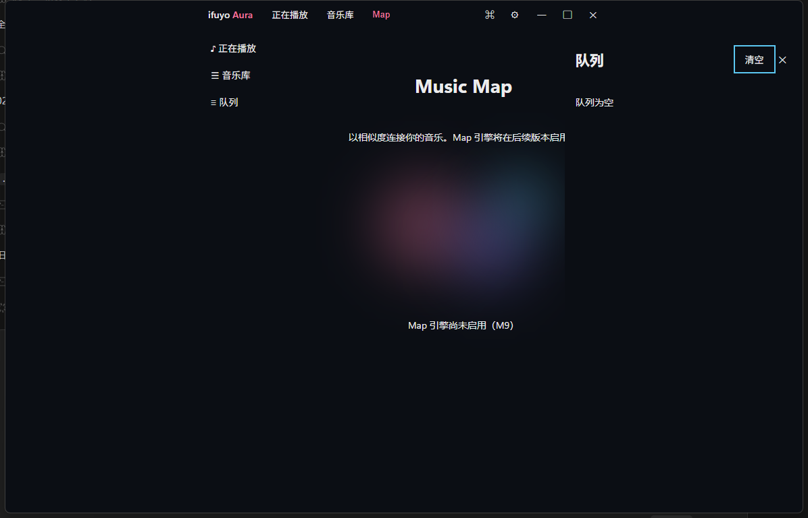
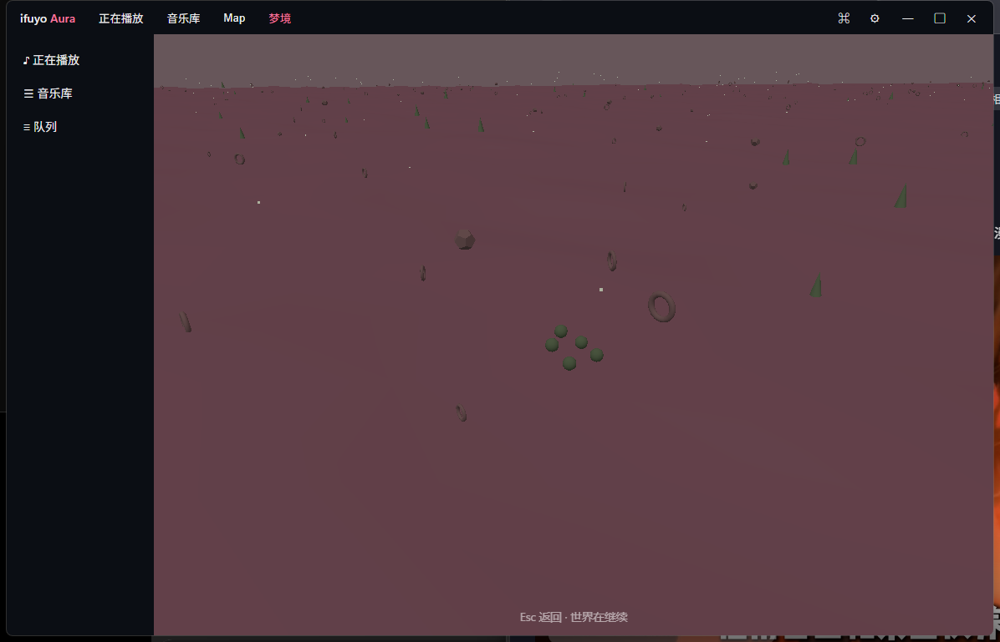
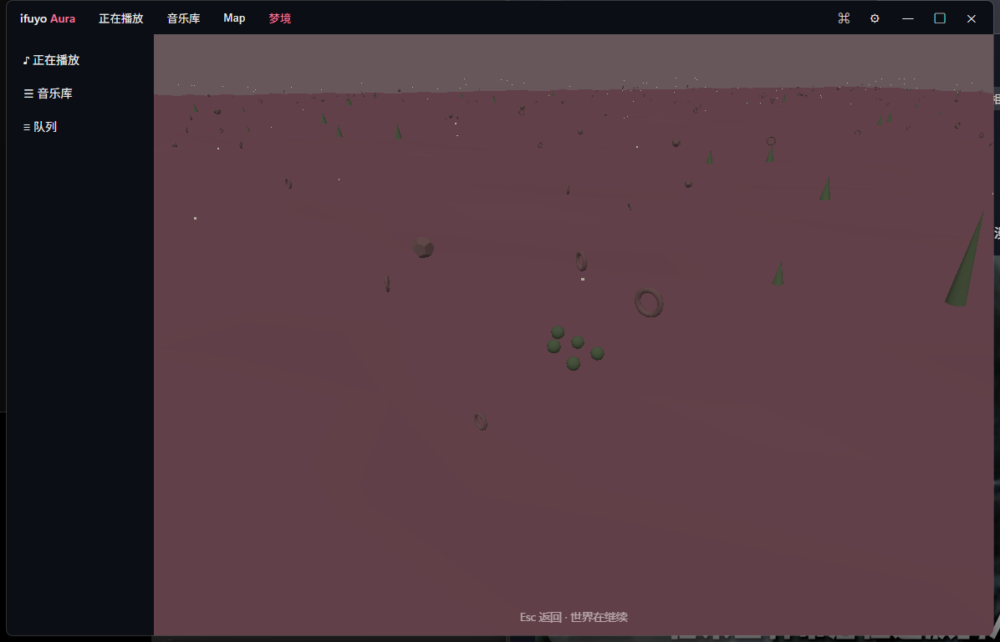

# ifuyo Aura

> 以光与梦，编织每一次游玩。
> Weave light and dreams into every session.

**ifuyo Aura** 是一款面向 Windows 的本地优先、合法来源、零遥测的桌面音乐播放器（Tauri 2 + Rust + React）。
**ifuyo Aura** is a local-first, legal-source, telemetry-free desktop music player for Windows (Tauri 2 + Rust + React).

---

## 当前状态（M6）

Music Map 根据本地音频分析结果，把音乐库组织成可探索的相似关系空间（§546：本地 M8 嵌入 → cosine 相似度 → kNN 图 → 确定性聚类与 2D 布局；不做任何"AI 理解品味"式宣称，全部数据本地生成）。
下表是**当前真实状态**（§310，不宣称未实现功能）：

| Feature | Status |
| --- | --- |
| 本地播放（FLAC/MP3/OGG/WAV/M4A/ALAC） | ✅ |
| Gapless / Crossfade / Loudness | ✅ |
| EQ（10-band 预设） | ✅ |
| 音乐库（扫描/FTS5 搜索/中文/CJK/artwork/watcher） | ✅ |
| 直链 HTTP(S) 来源 | ✅ |
| Internet Radio（ICY metadata） | ✅ |
| Radio Browser | ✅ |
| 持久缓存（分块/WAL/LRU/pin/完整性） | ✅ |
| Now Playing / Queue / Mini Player | ✅ |
| Command Palette（Ctrl+K） | ✅ |
| Aurora 视觉（WebGL fbm，播放响应） | ✅ |
| Win11 Mica（Win10 solid fallback） | ✅ |
| Music Map（相似度地图：构建/Canvas 渲染/搜索/过滤） | ✅ |
| Dreamscape（程序化世界：seed/演化/稀有事件/快照 + Three.js 渲染） | ✅ |
| Analysis（LUFS/Tempo/Key/Spectral/MFCC 本地确定性分析） | ✅ |
| SMTC / 托盘 / 媒体键 | M10 |

## 截图（来自当前真实构建）

| | |
| --- | --- |
|  |  |
|  |  |
|  |  |
|  |  |

## 安全与隐私

- **无遥测、无分析、无账户、无云同步**；联网仅发生在你主动播放直链 URL / 浏览电台时（详见 [PRIVACY.md](PRIVACY.md) / [SECURITY.md](SECURITY.md)）。
- 不支持也无法用于商业平台音源提取（YouTube/Spotify/网易云等 URL 会被 `config/unsupported_platforms.json` 封锁表直接拒绝）。
- 不捆绑任何音乐内容；不自动扫描 Documents/Desktop/全盘——音乐目录由你显式添加。

## 当前限制（如实）

- Aurora FPS 绝对值未在真实 GPU 桌面环境采样（机制已内建：`canvas[data-fps]`）；Mica 视觉效果需 Win11 实机确认（API + fallback 已就绪）。
- Dreamscape 为第一版视觉（无阴影/后处理特效栈）；full-screen 模式、手动天气预设、多世界 slots 未实现。数小时桌面 soak 未在本环境执行。
- 音乐分析：合成 fixture 全过；真实音乐 BPM/Key 精度未做基准评估（算法为经典统计法，非 ML）。
- 数小时级桌面 soak 未在本开发环境执行（远程虚拟显示）；本地复测脚本见 `docs/PERF.md`。
- 安装包（NSIS bundle）未签名；M6 已实际产出 unsigned 产物（`tauri build`）。

## 构建

前置：Rust stable（MSVC）+ Node 20+ + WebView2 Runtime。

```powershell
# 前端
cd ui
npm install
npm run build          # 产出 ui/dist

# 桌面应用（内嵌 dist；等价 tauri build 的编译段）
cd ..
cargo build --release -p aura-shell --features custom-protocol
# 产物：target/release/aura-shell.exe

# 或走 Tauri CLI（若已安装 cargo tauri / npx tauri）
cargo tauri build      # unsigned 产物
```

注意：`ui/dist` 变化不会自动触发 cargo 重编译（D-075）——重打包前 touch `src-tauri/src/lib.rs`。

## 开发

```powershell
cd ui && npm run dev          # Vite dev server (5173)
cargo run -p aura-shell       # 另一终端；debug 构建连 devUrl
```

门禁（CI 同款）：

```powershell
cargo fmt --check
cargo clippy --workspace --all-targets -- -D warnings
cargo test --workspace
cargo deny check
cd ui && npm run typecheck && npm run lint && npm test && npm run build
```

桌面冒烟（真实窗口）：`cargo run -p aura-shell --bin smoke`。

架构见 [ARCHITECTURE.md](ARCHITECTURE.md)；决策记录见 [DECISIONS.md](DECISIONS.md)；里程碑进度见 [PROGRESS.md](PROGRESS.md)。
