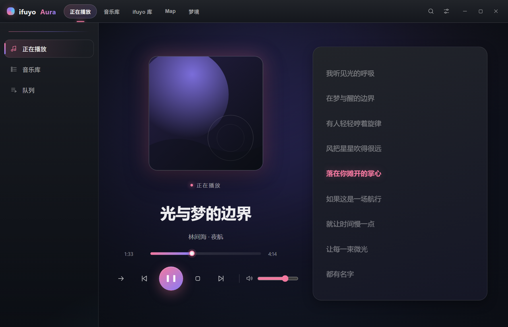
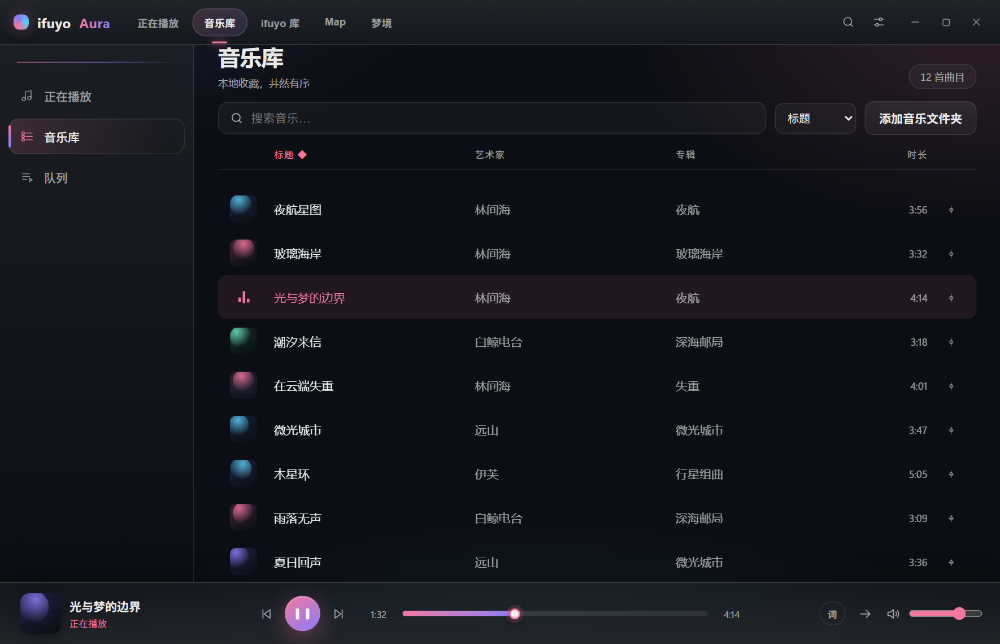
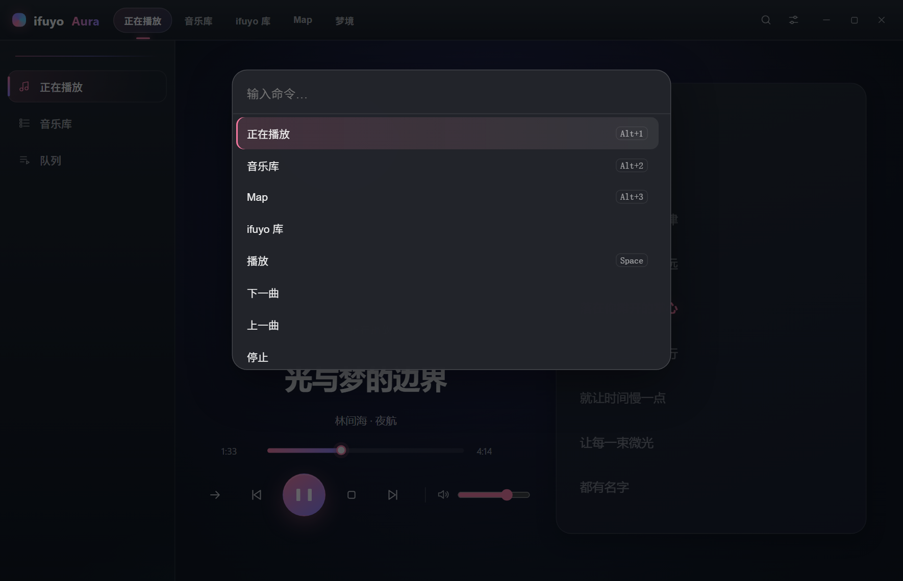
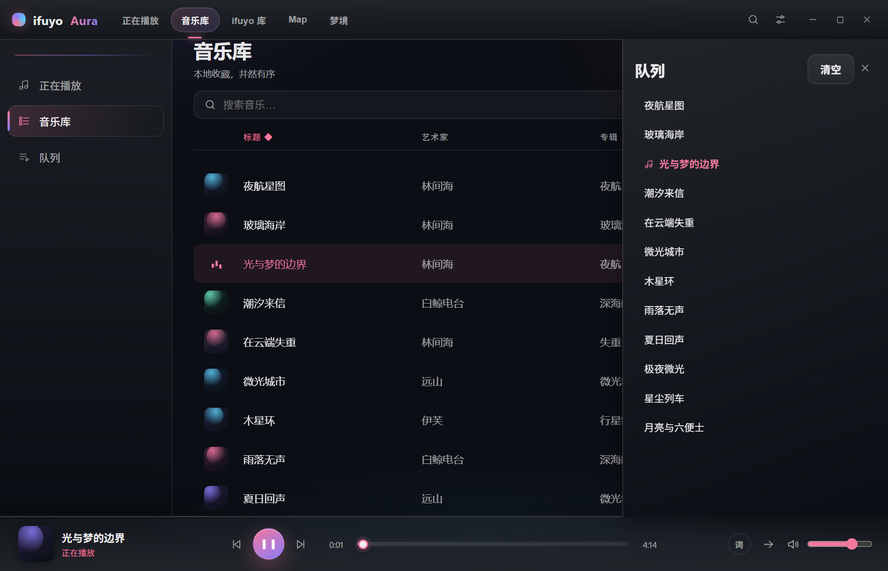

# ifuyo Aura

**以光与梦，编织每一次游玩。**

面向 Windows 的本地优先、合法来源、零遥测桌面音乐播放器。
基于 Tauri 2 + Rust + React。

[English](README.md) · **简体中文**

[](#许可)
[](#构建)
[](https://tauri.app)



## 为什么是 ifuyo Aura

- **本地优先。** 曲库始终留在你的磁盘上：无账号、无云同步、不上传。
- **只做合法来源。** 本地文件、直链 HTTP(S)、网络电台，以及自托管清单；商业平台音源提取在设计上直接拒绝。
- **零遥测。** 没有统计、没有追踪、没有“回家报到”。只有你主动播放直链或浏览电台时才会联网。
- **克制但完备。** 无缝播放、淡入淡出、响度归一、10 段均衡器、命令面板，以及完全在本机生成的音乐地图。

## 功能

| 方面 | 内容 |
| --- | --- |
| 播放 | FLAC / MP3 / OGG / WAV / M4A / ALAC、无缝播放、0–12s 淡入淡出、响度归一（−16 LUFS）、10 段 EQ 与预设 |
| 曲库 | 文件夹扫描、SQLite FTS5 搜索（含中文/CJK）、封面提取、文件监听、大库分页 |
| 来源 | 直链 HTTP(S) 音频、带 ICY 元数据的网络电台、Radio Browser、自托管 **ifuyo** 清单 |
| 缓存 | 分块 Range 缓存、WAL、LRU 淘汰、pin、完整性校验 |
| 视图 | 正在播放、音乐库、队列抽屉、迷你播放器、桌面置顶歌词、音乐地图、梦境 |
| 音乐地图 | 本地音频分析 → cosine 相似度 → k-NN 图 → 确定性 2D 布局；搜索、过滤、邻居 |
| 梦境 | 由曲目特征与实时电平驱动的确定性光场（WebGL2 + CSS 降级） |
| Windows | SMTC（系统媒体面板与媒体键）、托盘菜单、单实例、Win11 Mica（Win10 纯色降级） |
| 体验 | 命令面板（`Ctrl+K`）、`Alt+1…4` 导航、键盘优先、尊重“减少动态效果” |
| 语言 | English 与简体中文，运行时切换 |

## 截图

以下截图取自真实界面；曲库内容为虚构的演示数据集，并非随包附带的音乐。

| 正在播放 | 音乐库 |
| --- | --- |
|  |  |
| **命令面板** | **队列** |
|  |  |

截图可用 `node scripts/capture-readme-shots.mjs` 复现（无头 Edge + 模拟 IPC 层）。英文截图位于 [`docs/screenshots/en`](docs/screenshots/en)，供 [English README](README.md) 使用。

## 构建

前置：Rust stable（MSVC）+ Node.js 20+ + WebView2 Runtime。

```powershell
# 前端
cd ui
npm install
npm run build            # 产出 ui/dist

# 桌面应用（内嵌 ui/dist；等价 tauri build 的编译段）
cd ..
cargo build --release -p aura-shell --features custom-protocol
# 产物：target/release/aura-shell.exe

# 或走 Tauri CLI
cargo tauri build        # unsigned 产物
```

> `ui/dist` 变化不会自动触发 cargo 重编译（D-075）——重打包前 touch `src-tauri/src/lib.rs`。

## 开发

```powershell
cd ui && npm run dev     # Vite dev server（:5173）
cargo run -p aura-shell  # 另一终端；debug 构建使用 devUrl
```

门禁（与 CI 同款）：

```powershell
cargo fmt --check
cargo clippy --workspace --all-targets -- -D warnings
cargo test --workspace
cargo deny check
cd ui && npm run typecheck && npm run lint && npm test && npm run build
```

桌面冒烟（真实窗口）：`cargo run -p aura-shell --bin smoke`。

架构见 [ARCHITECTURE.md](ARCHITECTURE.md)；决策记录见 [DECISIONS.md](DECISIONS.md)；里程碑进度见 [PROGRESS.md](PROGRESS.md)；变更日志见 [CHANGELOG.md](CHANGELOG.md)。

## 隐私

- **无遥测、无统计、无账户、无云同步。** 只有你主动播放直链或浏览电台时才会联网。
- 不捆绑任何音乐；不自动扫描文档/桌面/全盘——音乐目录由你显式添加。
- YouTube、Spotify、网易云等商业平台 URL 会被 `config/unsupported_platforms.json` 的封锁表直接拒绝，且**不会发出任何请求**。

完整数据流见 [PRIVACY.md](PRIVACY.md)。

## 安全

> 安全策略以英文维护，以下为摘要；完整内容见 [SECURITY.md](SECURITY.md)。

ifuyo Aura is pre-alpha software. Security design highlights:

- **Strict URL policy.** Only `http`/`https`; URL credentials rejected; every redirect hop is re-validated (max 5 hops); private-network and loopback targets are denied unless the user explicitly confirms a LAN source; DNS results are re-checked on every resolution to prevent rebinding.
- **Bounded inputs.** Response bodies, ICY metadata, redirects, batch sizes, seek values, volume, crossfade and EQ indices are all clamped or rejected at the IPC boundary; persisted settings are normalized on read and write.
- **Minimal capabilities.** Tauri allowlist is limited to window controls and dialogs — no shell, no arbitrary filesystem or HTTP plugin. CSP blocks remote scripts, styles, fonts and images.
- **Local-only state.** Credentials (if a source ever needs them) go to Windows Credential Manager, never to disk or logs. Log messages redact URL userinfo and query strings.
- **Update integrity.** Manifests are validated and downgrade-rejected; release signatures are verified before installation.

Report vulnerabilities through GitHub **Security Advisories** (private). Please do not open a public issue with details.

## 当前状态与如实限制

- 安装包**未签名**；仓库内的更新端点是开发/假服务器，不是可用的公网自动更新通道。
- 音乐分析使用经典统计算法（非 ML）；真实音乐的 BPM/调性精度尚未做基准评估。
- 梦境为光场渲染（fBm 极光幕、星野、光尘、镜面）；full-screen 模式、天气预设、多世界 slots 未实现。
- 数小时级桌面 soak 未在本开发环境执行（远程虚拟显示）。
- Mica 已在 Win11 确认；Windows 10 按设计降级为纯色表面。

## 许可

本项目采用双许可，任选其一：

- **Apache License, Version 2.0** — [LICENSE-APACHE](LICENSE-APACHE)
- **MIT License** — [LICENSE-MIT](LICENSE-MIT)

除非另有明确说明，你有意提交以纳入本项目的任何贡献，均按上述双许可授权，不附加额外条款。

第三方声明：[THIRD_PARTY_LICENSES.md](THIRD_PARTY_LICENSES.md) · 内容规则：[CONTENT_POLICY.md](CONTENT_POLICY.md) · 来源政策：[SOURCES.md](SOURCES.md)。

---

Copyright © 2026 ifuyo · 伊芙游 · <https://ifuyo.com>
